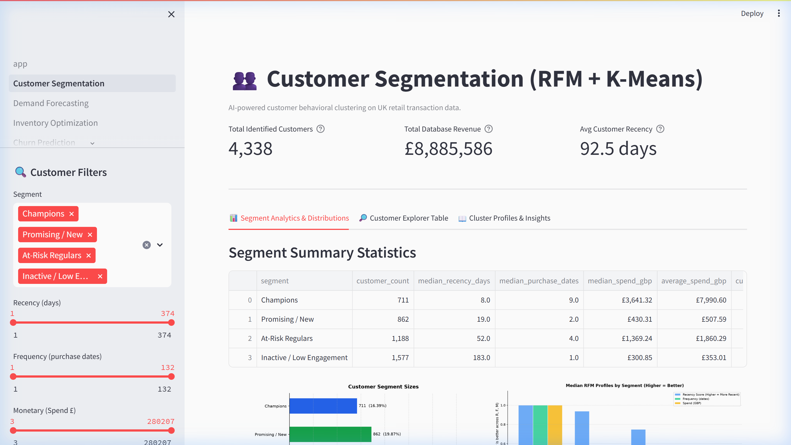
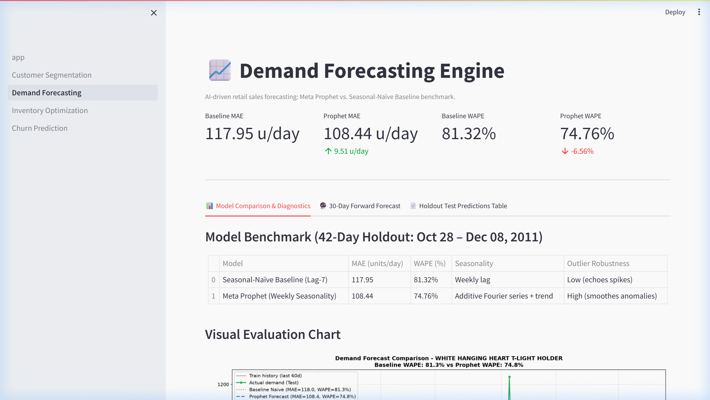
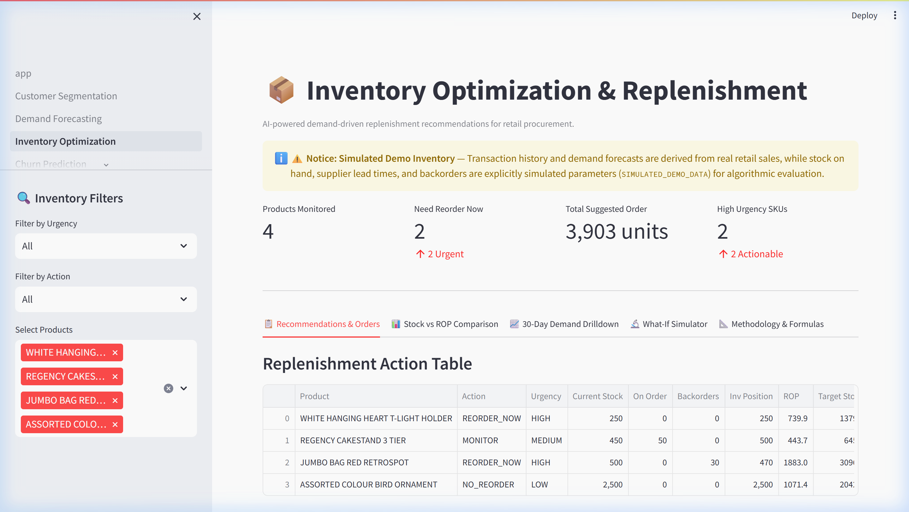
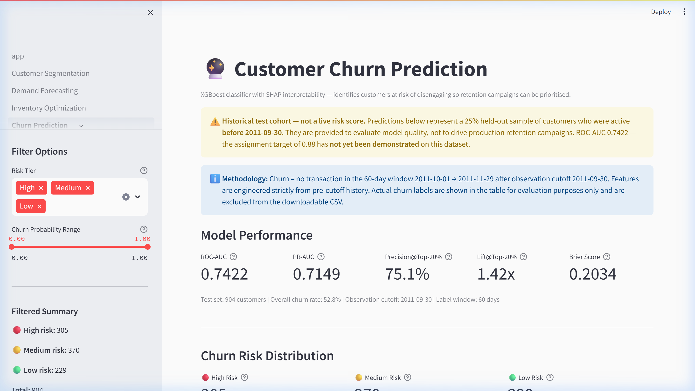
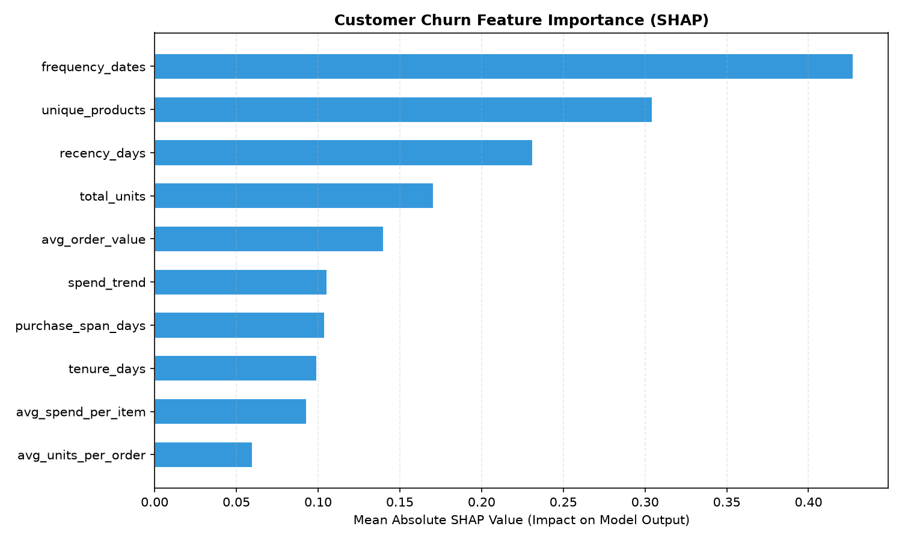

<div align="center">

# 🛍️ RetailPulse
### AI-Powered Retail Analytics Platform

[](https://github.com/UdayBansalG0423/Retail_Pulse/actions/workflows/ci.yml)
[](https://github.com/UdayBansalG0423/Retail_Pulse/actions/workflows/tests.yml)


**End-to-end retail intelligence: customer segmentation · demand forecasting · inventory replenishment · churn prediction**

*Internship project — Zidio Development · Dataset: UCI Online Retail (Dec 2010 – Dec 2011)*

</div>

---

## 📸 Dashboard Preview


*Executive KPI Cockpit — 4,338 customers · £8.9M revenue tracked · 5 live metrics across all modules*

---

## 🚀 What RetailPulse Does

RetailPulse transforms a raw transactional dataset into four interconnected AI decision-support tools, all surfaced through an interactive Streamlit dashboard.

| # | Module | AI Method | Key Result |
|---|--------|-----------|-----------|
| 1 | 👥 Customer Segmentation | RFM + K-Means (k=4) | 4,338 customers → 4 behavioural segments |
| 2 | 📈 Demand Forecasting | Meta Prophet vs Seasonal-Naïve | WAPE 74.76% on 42-day holdout (−6.6 pp vs baseline) |
| 3 | 📦 Inventory Optimisation | Target-Stock (s, S) policy | ROP · Target Stock · What-If Simulator |
| 4 | 🔮 Churn Prediction | XGBoost + SHAP | ROC-AUC 0.7422 · Precision@Top-20%: 75.14% · Lift: 1.42× |

> ⚠️ **Honest reporting:** The assignment specifies MAPE ≤ 12% and ROC-AUC ≥ 0.88. Measured results on held-out data are **WAPE 74.76%** and **AUC 0.7422**. Neither target has been achieved on this dataset and both are documented as such.

---

## 📊 Module Walkthroughs

### 1. 👥 Customer Segmentation



**What it does:**
- Extracts **Recency**, **Frequency** (distinct purchase dates), and **Monetary** features from 524,000+ transactions
- Applies log-transformation → standard scaling → K-Means clustering (k=4)
- Labels each cluster using RFM score quartiles

**Segments discovered:**

| Segment | Behaviour | Action |
|---------|-----------|--------|
| 🏆 Champions | High spend · frequent · recent | Reward & upsell |
| 💚 Loyal Customers | Consistent repeat buyers | Nurture & cross-sell |
| ⚠️ At-Risk | High past value · long gap | Win-back campaign |
| 💤 Inactive | Low frequency · long dormancy | Re-engagement or suppress |

**Dashboard features:** Real-time segment / spend / recency filters · Customer ID lookup · CSV export

---

### 2. 📈 Demand Forecasting



**What it does:**
- Aggregates daily transaction volume for pilot SKU: `WHITE HANGING HEART T-LIGHT HOLDER`
- Zero-fills closed/no-sale days to prevent information leakage
- Compares **Seasonal-Naïve Baseline (Lag-7)** vs **Meta Prophet** on a 42-day held-out window

**Holdout evaluation (2011-10-28 → 2011-12-08):**

| Model | MAE (units/day) | WAPE |
|-------|-----------------|------|
| Seasonal-Naïve Baseline | 117.95 | 81.32% |
| **Meta Prophet** | **108.44** | **74.76%** |
| Improvement | −8.1% MAE | −6.6 pp |

**Dashboard features:** Interactive holdout chart · Actual vs predicted overlay · 30-day forward projection curve

> **Note:** The high WAPE reflects extreme demand spikes and many zero-sale days in the dataset. The assignment MAPE ≤ 12% target has not been demonstrated.

---

### 3. 📦 Inventory Optimisation



**What it does:**
- Implements a continuous-review **Target-Stock (s, S) policy** driven by the 30-day Prophet forecast
- Calculates four key inventory quantities per SKU:

```
IP  = Stock + On Order − Backorders           (Inventory Position)
ROP = (d × L) + SS                            (Reorder Point)
T   = d × (L + R) + SS                       (Target Stock)
Q   = max(0, ⌈T − IP⌉)                       (Suggested Order Quantity)
```

**Action classification:**

| Action | Condition | Urgency |
|--------|-----------|---------|
| `REORDER_NOW` | IP < ROP | 🔴 High |
| `MONITOR` | ROP ≤ IP < T | 🟡 Medium |
| `NO_REORDER` | IP ≥ T | 🟢 Low |

**Dashboard features:** Urgency overview · Stock vs ROP comparison chart · What-If Simulator (adjust lead time & stock) · CSV export for procurement

> ⚠️ **Simulated inputs:** Stock on hand, supplier lead times, review periods, and backorders are explicitly labelled `SIMULATED_DEMO_DATA`. The demand signal `d` is from the real Prophet forecast.

---

### 4. 🔮 Churn Prediction



**What it does:**
- Defines churn as **no transaction in a 60-day window** after observation cutoff (2011-09-30 → 2011-11-29)
- Engineers 13 features per customer: recency, frequency, spend, diversity, trend, tenure
- Trains an **XGBoost classifier** on 75% of pre-cutoff customers and evaluates on 25% held-out test set
- Explains predictions using **SHAP** (SHapley Additive exPlanations)

**Evaluation metrics (held-out test set — 904 customers):**

| Metric | Value | Context |
|--------|-------|---------|
| ROC-AUC | **0.7422** | Assignment target: 0.88 (not yet achieved) |
| PR-AUC | 0.7149 | — |
| Precision@Top-20% | **75.14%** | vs 52.77% random baseline |
| Lift@Top-20% | **1.42×** | Targeting efficiency gain |
| Brier Score | 0.2034 | Calibration quality |

**SHAP Feature Importance:**


*SHAP beeswarm — each dot is one customer; colour = feature value magnitude; position = impact on churn probability*

**Top predictors:**

| Rank | Feature | Mean \|SHAP\| | Interpretation |
|------|---------|--------------|----------------|
| 1 | `frequency_dates` | 0.4275 | Customers who buy more often churn less |
| 2 | `unique_products` | 0.3046 | Broader basket → stronger engagement |
| 3 | `recency_days` | 0.2312 | More recent buyers are less likely to churn |
| 4 | `total_units` | 0.1707 | Higher volume correlates with retention |
| 5 | `avg_order_value` | 0.1400 | Higher AOV signals committed customers |

**Dashboard features:** Risk-tier filter (High / Medium / Low) · Probability histogram · Customer table with progress bars · Per-customer lookup with gauge chart · CSV export (actual labels excluded from download)

> ⚠️ **Scope:** The churn page scores a **held-out historical test cohort**, not live current customers. Results should not be interpreted as production campaign recommendations.

---

## 🏗️ Repository Structure

```
RetailPulse/
├── .github/workflows/
│   ├── ci.yml                           # Fast core regression tests (~30 s)
│   └── tests.yml                        # Full dependency test suite
│
├── dashboard/
│   ├── app.py                           # Executive Hub — 5-metric KPI cockpit
│   └── pages/
│       ├── 1_Customer_Segmentation.py   # RFM clustering & Customer Explorer
│       ├── 2_Demand_Forecasting.py      # Prophet evaluation & 30-day curves
│       ├── 3_Inventory_Optimization.py  # Stock coverage, ROP & What-If Simulator
│       └── 4_Churn_Prediction.py        # XGBoost risk tiers, SHAP, customer lookup
│
├── src/
│   ├── data/                            # Ingestion, validation & cleaning
│   ├── segmentation/                    # RFM modelling & cluster evaluation
│   ├── forecasting/                     # Data aggregation, baseline & Prophet
│   ├── inventory/                       # Sample inventory & optimiser engine
│   └── churn/                           # XGBoost training & SHAP interpretability
│
├── tests/
│   ├── test_customer_segmentation.py    # 4 filter regression tests
│   ├── test_forecasting.py              # 4 holdout alignment tests
│   ├── test_inventory_optimizer.py      # 8 replenishment rule unit tests
│   └── test_churn_prediction.py         # 3 metric & probability bound tests
│
├── models/
│   └── churn_xgb.json                   # Trained XGBoost model (tracked, ~415 KB)
│
├── reports/churn/
│   ├── churn_metrics.json               # Held-out evaluation metrics
│   ├── churn_shap_importance.csv        # Mean |SHAP| per feature
│   └── churn_shap_summary.png           # SHAP beeswarm visualisation
│
├── docs/assets/                         # README screenshots & diagrams
├── setup_pipeline.py                    # Single-command pipeline runner
└── requirements.txt
```

---

## ⚡ Quickstart

### 1 · Clone and set up environment

```bash
git clone https://github.com/UdayBansalG0423/Retail_Pulse.git
cd Retail_Pulse

python -m venv .venv
.venv\Scripts\activate          # Windows
# source .venv/bin/activate     # Linux / macOS

pip install -r requirements.txt
```

### 2 · Run the full pipeline

```bash
python setup_pipeline.py
```

This runs all 5 stages in order and prints status for each:

```
Stage 1 · Data ingestion & cleaning
Stage 2 · Customer segmentation
Stage 3 · Demand forecasting
Stage 4 · Inventory optimisation
Stage 5 · Churn prediction
```

Or run stages individually:

```bash
# Segmentation
python src/segmentation/rfm_segmentation.py
python src/segmentation/label_and_visualize.py

# Forecasting
python src/forecasting/prepare_sales.py
python src/forecasting/forecast_baseline.py
python src/forecasting/prophet_forecast.py
python src/forecasting/generate_future_forecast.py

# Inventory
python src/inventory/create_sample_inventory.py
python src/inventory/inventory_optimizer.py

# Churn
python src/churn/churn_prediction.py
```

### 3 · Run the test suite

```bash
python -m compileall -q src dashboard tests
python -m unittest discover -s tests -v
```

Expected output:
```
Ran 19 tests in ~0.03s
OK (skipped=N)    ← skips when generated CSVs or optional deps are absent
```

### 4 · Launch the dashboard

```bash
streamlit run dashboard/app.py
```

Open **http://localhost:8501** — all four pages are in the left sidebar.

---

## 🔬 Technical Architecture

```
                         UCI Online Retail Dataset
                                   │
                    ┌──────────────▼──────────────┐
                    │    Data Ingestion & Cleaning  │
                    │    (524K+ validated rows)     │
                    └──────────────┬──────────────┘
                                   │
          ┌────────────────────────┼────────────────────────┐
          │                        │                        │
          ▼                        ▼                        ▼
   ┌─────────────┐        ┌──────────────┐        ┌──────────────┐
   │     RFM     │        │  Daily Sales │        │  Customer    │
   │  Features   │        │  Time Series │        │  Features    │
   └──────┬──────┘        └──────┬───────┘        └──────┬───────┘
          │                      │                       │
          ▼                      ▼                       ▼
   ┌─────────────┐     ┌──────────────────┐    ┌──────────────────┐
   │   K-Means   │     │  Meta Prophet    │    │    XGBoost       │
   │  Clustering │     │  + Inventory     │    │  + SHAP EXPLAIN  │
   │  (k = 4)    │     │  Optimizer (s,S) │    │  (Churn Risk)    │
   └──────┬──────┘     └────────┬─────────┘    └────────┬─────────┘
          │                     │                        │
          └─────────────────────┼────────────────────────┘
                                │
                    ┌───────────▼───────────┐
                    │  Streamlit Dashboard  │
                    │  4 pages + KPI Hub    │
                    └───────────────────────┘
```

---

## 📋 Reproducibility Notes

| Concern | Detail |
|---------|--------|
| **Raw data** | Excluded from Git (`data/raw/*`). Re-downloaded automatically by `src/data/ingest_data.py` via `ucimlrepo`. |
| **Processed CSVs** | Excluded from Git (`data/processed/*`). Regenerated by `setup_pipeline.py`. |
| **Churn model** | `models/churn_xgb.json` tracked in Git (415 KB). Deterministic with `RANDOM_STATE=42`. |
| **SHAP reports** | `reports/churn/` tracked in Git. |
| **Inventory inputs** | All warehouse parameters are `SIMULATED_DEMO_DATA` — demand `d` is from real Prophet forecast. |
| **Dataset scope** | UCI Online Retail (not Online Retail II). Dec 2010 – Dec 2011. UK customers only after cleaning. |

---

## 🧪 Test Coverage

| Test File | Tests | Guards |
|-----------|-------|--------|
| `test_customer_segmentation.py` | 4 | Skips if `customer_rfm.csv` absent |
| `test_forecasting.py` | 4 | Skips if forecast CSVs absent |
| `test_inventory_optimizer.py` | 8 | Pure unit tests — no file deps |
| `test_churn_prediction.py` | 3 | Skips if `xgboost` not installed |
| **Total** | **19** | **0 failures in CI** |

---

## 📜 License & Acknowledgements

- **Dataset:** [UCI Online Retail](https://archive.ics.uci.edu/dataset/352/online+retail) — Dr. Daqing Chen, London South Bank University. UCI Machine Learning Repository, 2015.
- **Internship project** for [Zidio Development](https://zidio.in).
- Built with [Streamlit](https://streamlit.io) · [Meta Prophet](https://facebook.github.io/prophet/) · [XGBoost](https://xgboost.readthedocs.io) · [SHAP](https://shap.readthedocs.io)
